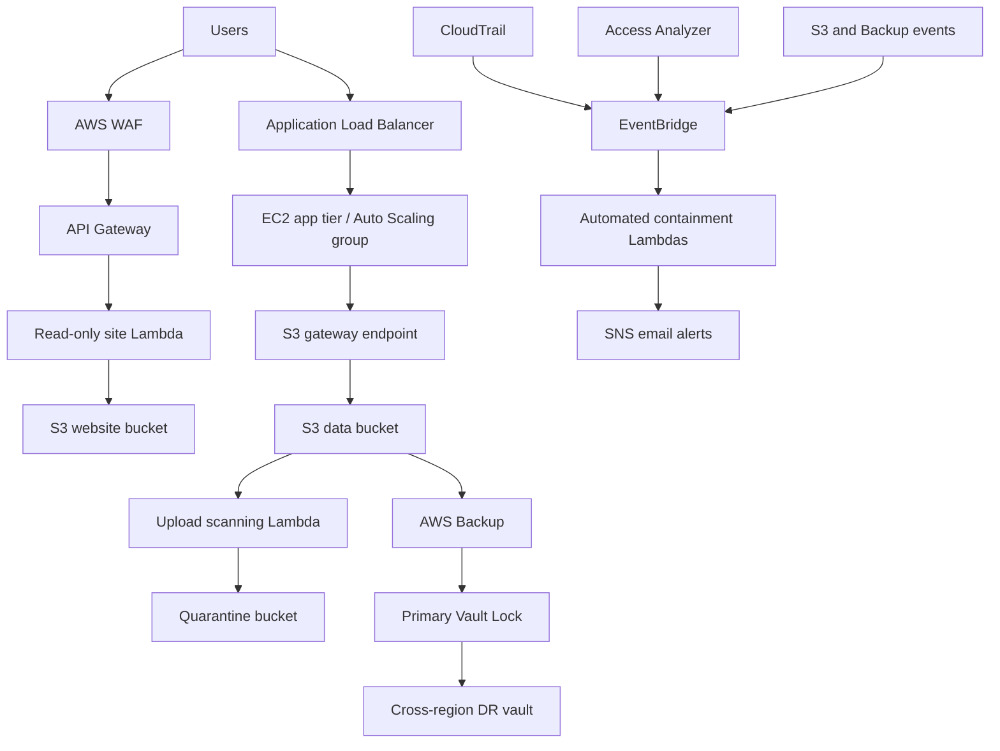

<h1 align="center"> CloudShield 360</h1> <p align="center"><b>Serverless, ransomware-resilient AWS architecture with three-tier network segmentation and automated containment, built with Terraform.</b></p> <p align="center">       </p> <p align="center"> Prefer a styled page? Open <a href="docs/index.html"><code>docs/index.html</code></a> (or enable GitHub Pages on the <code>docs</code> folder).</p>

---

## Contents

- [ Overview](#-overview)
- [ Architecture](#-architecture)
- [ What is inside](#-what-is-inside)
- [ Before you start](#-before-you-start)
- [ Step-by-step guide](#-step-by-step-guide)
- [ One-pass run (Windows PowerShell)](#-one-pass-run-windows-powershell)
- [ Troubleshooting](#-troubleshooting)
- [ Limits and safety](#-limits-and-safety)

## Overview

CloudShield 360 protects a web application and its data against ransomware and similar attacks. It keeps everything private, scans uploads, keeps **locked backups with a cross-region copy**, detects risky activity and **automatically isolates** a compromised file, identity, bucket or EC2 instance. Everything is created with Terraform in **one AWS account**.

|     | Feature                    | What it does                                                                                               |
| --- | -------------------------- | ---------------------------------------------------------------------------------------------------------- |
|     | **Private by design**      | S3 buckets are never public. The site is served through WAF, API Gateway and a read-only Lambda.           |
|     | **Network segmentation**   | Public, app and data tiers with their own subnets and security groups. The app tier has no internet route. |
|     | **Immutable backups**      | AWS Backup with Vault Lock, plus a copy in a second region.                                                |
|     | **Upload scanning**        | Every upload is checked. Dangerous files are tagged, quarantined and removed.                              |
|     | **Event-driven detection** | CloudTrail, Access Analyzer and EventBridge rules raise email alerts through SNS.                          |
|     | **Automated containment**  | Four Lambda functions isolate users, buckets, files and EC2 instances.                                     |

## Architecture



### Network tiers

| Tier       | Resources                                                        | Network rule                                                                                 |
| ---------- | ---------------------------------------------------------------- | -------------------------------------------------------------------------------------------- |
| **Public** | Application Load Balancer, regional WAF, internet gateway        | The internet can reach only the load balancer                                                |
| **App**    | EC2 in an Auto Scaling group, private subnets, no internet route | Accepts port 8080 from the load balancer only; SSH only through an Instance Connect Endpoint |
| **Data**   | S3 data bucket                                                   | Reached from the app tier only through an S3 gateway endpoint with an endpoint policy        |

### Segmentation zones

| Zone       | Contains                                  | Who can access it                                        |
| ---------- | ----------------------------------------- | -------------------------------------------------------- |
| Edge       | WAF, API Gateway, load balancer           | Public internet, read only                               |
| Website    | Site function, website bucket             | The site function role reads the bucket                  |
| Data       | Data bucket (versioned, scanned)          | App role (`app/` prefix only), backup role, scanner role |
| Quarantine | Quarantine bucket                         | Scanner writes; `ir-responder` reads (MFA)               |
| Backup     | Two locked vaults (primary and DR region) | Backup role only                                         |
| Response   | Four containment functions                | Triggered by EventBridge only                            |

**Extras:** IMDSv2 only, encrypted volumes, a locked default security group, a quarantine security group with no traffic, VPC flow logs to the logs bucket, and a Vault Lock cooling-off period.

## What is inside

| File or folder                         | Purpose                                                                                                |
| -------------------------------------- | ------------------------------------------------------------------------------------------------------ |
| `providers.tf`                         | Primary region, DR region, us-east-1 (event forwarding)                                                |
| `s3.tf`                                | Website, data, logs and quarantine buckets, encryption, versioning, bucket policies, sample site       |
| `website.tf`                           | Site function, API Gateway, regional WAF                                                               |
| `network.tf`                           | VPC, subnets, route tables, S3 endpoint, security groups, Instance Connect Endpoint, flow logs         |
| `compute.tf`                           | Instance role, launch template, load balancer, Auto Scaling group                                      |
| `backup.tf`                            | Backup role, locked vaults, backup plan and selection                                                  |
| `security.tf`, `monitoring.tf`         | Access Analyzer, event forwarding, CloudTrail, SNS and alert rules                                     |
| `containment.tf`, `containment_ec2.tf` | Responder role, four containment functions and their triggers                                          |
| `lambda/`                              | Python source: `site_server`, `scan_object`, `isolate_principal`, `isolate_bucket`, `isolate_instance` |
| `tests/`                               | Sample events for testing the functions                                                                |

## Before you start

- [ ] An AWS account (free-tier or credits) and a mailbox you can open now
- [ ] AWS CLI v2 and Terraform 1.5 or newer
- [ ] Windows PowerShell or any terminal (commands below use PowerShell)
- [ ] About 30 minutes for the first deployment and 1 hour for the full demo

> **Heads up:** Cost: the load balancer and EC2 instances draw on your credits. Destroy the stack as soon as you have your evidence.

## Step-by-step guide

## Step 1: Install the tools

- **AWS CLI v2** and **Terraform 1.5+** (Git and VS Code are optional).

powershell

```powershell
winget install Amazon.AWSCLI
winget install Hashicorp.Terraform
aws --version
terraform -version
```

## Step 2: Prepare your AWS account

1. Sign in as the root user, open the account menu, **Security credentials**, and turn on MFA.
2. Go to **IAM, Users, Create user**. Name it `admin`, choose **Attach policies directly**, tick `AdministratorAccess`, and create it. The project creates IAM roles, WAF and a VPC, so it needs broad rights.
3. Open the user, **Security credentials**: assign an MFA device, then **Create access key**, choose _Command Line Interface_, and copy both values.
4. Go to **Billing and Cost Management, Budgets, Create budget**, choose _Zero spend budget_ and enter your email.
5. Save the key in the CLI and check it:

powershell

```powershell
aws configure # key id, secret, region ap-south-1, output json
aws sts get-caller-identity
```

> **Tip:** The identity that runs Terraform is protected automatically: containment will never isolate it.

> ℹ **Note:** This edition does not use CloudFront, GuardDuty or Security Hub, which are often blocked on new accounts. If the load balancer or EC2 is refused with an activation or verification error, open an AWS Support case (Account and billing) and re-run.

## Step 3: Configure the project

powershell

```powershell
Copy-Item terraform.tfvars.example terraform.tfvars
notepad terraform.tfvars
```

| Variable                         | Default                     | What to do                                                      |
| -------------------------------- | --------------------------- | --------------------------------------------------------------- |
| `alert_email`                    | none                        | **Required.** The mailbox that receives alerts                  |
| `primary_region` / `dr_region`   | ap-south-1 / ap-southeast-1 | Change only if you must                                         |
| `alb_ingress_cidrs`              | `["0.0.0.0/0"]`             | Narrow to your own IP, for example `["203.0.113.7/32"]`         |
| `asg_desired_capacity`           | 1                           | Use 2 for the EC2 isolation demo, so one instance keeps serving |
| `containment_mode`               | `enforce`                   | Use `dry_run` to get alerts without any change                  |
| `retention_days`                 | 7                           | Recovery point retention                                        |
| `vault_lock_changeable_for_days` | 3                           | Vault Lock cooling-off window (minimum 3)                       |
| `protected_principals`           | empty                       | Admin names that must never be auto-isolated                    |

## Step 4: Deploy

powershell

```powershell
terraform init -upgrade
terraform validate
terraform plan -out tfplan
terraform apply tfplan
```

- The apply takes about 5 minutes. The first EC2 instance needs another 3 to 5 minutes to become healthy.
- When it ends, run `terraform output` to see the website URL, load balancer URL and bucket names.

> **Tip:** Prefer one command? See _One-pass run_ below.

## Step 5: Confirm the alert email

1. Open the email titled _AWS Notification - Subscription Confirmation_ (check spam) and click **Confirm subscription**.
2. In the console open **SNS, Subscriptions** and check the status is **Confirmed**.

## Step 6: Verify the deployment

powershell

```powershell
$env:AWS_PAGER=""
$API = terraform output -raw website_url
$ALB = terraform output -raw alb_url
$DATA = terraform output -raw data_bucket
$WEB = terraform output -raw website_bucket
$QUAR = terraform output -raw quarantine_bucket
$LOGS = $DATA -replace '-data$','-logs'

curl.exe -s -o NUL -w "%{http_code}" $API
curl.exe -s -o NUL -w "%{http_code}" $ALB
curl.exe -G -i --data-urlencode "x=<script>alert(1)</script>" $API
```

| Check                      | Expected                                               |
| -------------------------- | ------------------------------------------------------ |
| Website URL (`$API`)       | `200` and the CloudShield 360 page                     |
| Load balancer URL (`$ALB`) | `200` once an instance is healthy (wait a few minutes) |
| Script-injection request   | `403 Forbidden` from the WAF                           |

> **Heads up:** In Windows PowerShell, `curl` is an alias of `Invoke-WebRequest`. Always type `curl.exe`.

## Step 7: Test backups and Vault Lock

powershell

```powershell
"hello" | Set-Content hello.txt
aws s3 cp hello.txt "s3://$DATA/hello.txt"
```

1. Console: **AWS Backup, Dashboard, Create on-demand backup**.
2. Resource type **S3**, bucket = your data bucket, backup vault `<project>-prod-vault`, IAM role **Choose an IAM role** and pick `<project>-backup-role`, then **Create on-demand backup**.
3. **Jobs, Backup jobs**: status should become _Completed_. **Copy jobs** shows the cross-region copy.
4. Switch the console to the DR region, open **Vaults**, and check `<project>-prod-dr-vault` holds the copy.
5. Open a vault: the **Vault lock** section shows the lock and the cooling-off end date.

> **Important:** After the cooling-off period the Vault Lock is permanent. Run `terraform destroy` inside that window, or wait until recovery points expire.

## Step 8: Prove the network segmentation

**Show the tiers.** In the console open EC2, Load Balancers; EC2, Instances (no public IP); VPC, Route tables (the app table has no `0.0.0.0/0` route); VPC, Security groups; VPC, Endpoints, S3 endpoint, Policy.

**Connect inside the app tier.** EC2, Instances, select an app instance, **Connect**, tab **EC2 Instance Connect**, choose **Connect using EC2 Instance Connect Endpoint**, pick the `<project>-eice` endpoint, **Connect**. Then run:

| Command (inside the instance)                           | Expected               | Proves                                   |
| ------------------------------------------------------- | ---------------------- | ---------------------------------------- |
| `curl -m 5 https://example.com`                         | timeout                | No internet route                        |
| `curl -m 5 http://169.254.169.254/latest/meta-data/`    | `401`                  | IMDSv2 is enforced                       |
| `aws s3 ls s3://<data_bucket>/app/ --region ap-south-1` | lists a heartbeat file | Data tier reachable through the endpoint |
| `aws s3 ls s3://<website_bucket>/ --region ap-south-1`  | AccessDenied           | Role and endpoint policy limit access    |
| `aws s3 cp /tmp/t.txt s3://<data_bucket>/other/t.txt`   | AccessDenied           | Role limited to the `app/` prefix        |

**Flow logs.** After about 10 minutes, open AWS CloudShell and look for blocked traffic:

bash

```bash
aws s3 cp s3://<logs_bucket>/vpc-flow/ flow --recursive
zcat $(find flow -name "*.log.gz") | grep REJECT | head
```

## Step 9: Prove identity and policy segmentation

powershell

```powershell
aws iam create-user --user-name demo-attacker
Set-Content demo-policy.json '{"Version":"2012-10-17","Statement":[{"Effect":"Allow","Action":"backup:DeleteBackupVault","Resource":"*"}]}'
aws iam put-user-policy --user-name demo-attacker --policy-name demo --policy-document file://demo-policy.json
aws iam create-access-key --user-name demo-attacker
aws configure --profile attacker
aws configure set region ap-south-1 --profile attacker
aws s3 ls "s3://$DATA" --profile attacker
```

- The last command must fail with **AccessDenied**: this user cannot read your data.
- `curl.exe -s -o NUL -w "%{http_code}" "${API}secret.txt"` returns `404` for a file that only exists in the data bucket.
- In **IAM, Policy simulator**, `<project>-site-server-fn` can read the website bucket but not the data bucket.

> **Important:** Never share screenshots that show the secret access key or your account ID. Blur them first.

## Step 10: Trigger the containment

### A. Dangerous file

powershell

```powershell
"test" | Set-Content setup.exe
aws s3 cp setup.exe "s3://$DATA/setup.exe"
aws s3 ls "s3://$DATA/"
aws s3 ls "s3://$QUAR/" --recursive
```

Within a minute you get an email. `setup.exe` leaves the data bucket and appears in quarantine, tagged `ScanStatus=INFECTED`. Clean files are tagged `CLEAN`.

### B. Compromised identity

powershell

```powershell
aws backup delete-backup-vault --backup-vault-name demo-no-such-vault --region ap-south-1 --profile attacker
aws iam list-user-policies --user-name demo-attacker
aws iam list-access-keys --user-name demo-attacker
```

After 1 to 5 minutes: email _principal isolated_, the policy `CloudShieldQuarantineDenyAll` is attached and the key is `Inactive`. Repeating the attacker command now fails with _security token invalid_.

### C. Weakened bucket protection

powershell

```powershell
aws iam create-user --user-name demo-tamper
Set-Content tamper-policy.json '{"Version":"2012-10-17","Statement":[{"Effect":"Allow","Action":["s3:PutBucketPublicAccessBlock","s3:GetBucketPublicAccessBlock"],"Resource":"arn:aws:s3:::<data_bucket>"}]}'
aws iam put-user-policy --user-name demo-tamper --policy-name demo --policy-document file://tamper-policy.json
aws iam create-access-key --user-name demo-tamper
aws configure --profile tamper
aws configure set region ap-south-1 --profile tamper
aws s3api put-public-access-block --bucket $DATA --public-access-block-configuration BlockPublicAcls=true,IgnorePublicAcls=true,BlockPublicPolicy=true,RestrictPublicBuckets=true --profile tamper
aws s3 ls "s3://$DATA/"
```

The last command (as admin) is **denied** while the website still answers `200`: the isolation stays inside one segment.

**Release:** account menu, **Switch role**, enter your account ID and `<project>-ir-responder`, **Switch Role** (your user needs MFA). Open the data bucket, **Permissions, Bucket policy, Edit**, delete the statement with Sid `CloudShieldIsolateBucket`, **Save changes**.

### D. Compromised EC2 instance

powershell

```powershell
aws ec2 describe-instances --filters Name=tag:Project,Values=CloudShield360 Name=instance-state-name,Values=running --query "Reservations[].Instances[].InstanceId" --output text
aws ec2 create-tags --resources <instance-id> --tags Key=SecurityIsolate,Value=true
```

Within a few minutes: email _instance isolated_, the instance uses only the quarantine security group, forensic snapshots appear, and the Auto Scaling group launches a clean replacement while the load balancer keeps serving.

> **Tip:** If a trigger does not fire within 10 minutes, invoke the function directly with a file from `tests/` (see Troubleshooting).

## Step 11: Collect your evidence

- [ ] Route tables (public and app), the four security groups and the S3 endpoint policy
- [ ] The command table output from inside the app instance
- [ ] Flow log `REJECT` lines
- [ ] Backup job, copy job, both vaults and the Vault Lock page
- [ ] Quarantine bucket, the deny-all policy on `demo-attacker`, the isolated bucket and instance
- [ ] All alert emails

## Step 12: Clean up

1. Release any bucket isolation (data bucket must list normally for `terraform destroy`).
2. Terminate any isolated instance and delete the forensic snapshots:

powershell

```powershell
aws ec2 terminate-instances --instance-ids <instance-id>
aws ec2 describe-snapshots --owner-ids self --filters Name=tag:Project,Values=CloudShield360 --query "Snapshots[].SnapshotId" --output text
aws ec2 delete-snapshot --snapshot-id <snapshot-id>
```

1. Delete the demo users (`demo-attacker`, `demo-tamper`): delete their access keys and inline policies first, then the user.
2. Remove the `[attacker]` and `[tamper]` profiles from your AWS credentials and config files, and delete `demo-policy.json`, `tamper-policy.json`, `setup.exe`, `out.json`.
3. Run `terraform destroy` **inside the Vault Lock cooling-off window** (3 days by default).

> **Important:** An isolated instance that is still running blocks the destroy (subnet and security group in use). Terminate it first.

## One-pass run (Windows PowerShell)

1. `powershell -ExecutionPolicy Bypass -File scripts\deploy.ps1` checks credentials, runs init, validate and plan, asks, then applies.
2. Confirm the SNS email and wait 3-5 minutes for the instance to become healthy.
3. `powershell -ExecutionPolicy Bypass -File scripts\verify.ps1 -WithScanTest` prints PASS/FAIL for every tier.

> ℹ **Note:** These two scripts live in the `scripts/` folder of your repository. Keep that folder when you publish.

## Troubleshooting

| Symptom                                                   | Cause and fix                                                                                                                                              |
| --------------------------------------------------------- | ---------------------------------------------------------------------------------------------------------------------------------------------------------- |
| `curl` asks for `Uri:`                                    | PowerShell alias. Press `Ctrl+C` and use `curl.exe`                                                                                                        |
| `The config profile (cloudshield) could not be found`     | That profile name does not exist. Run `aws configure list-profiles`, then `Remove-Item Env:AWS_PROFILE` to use `default`                                   |
| Load balancer returns 502 or 503                          | The instance is still booting. Check **EC2, Target groups, Targets** and wait 3 to 5 minutes                                                               |
| Target stays unhealthy                                    | Check the instance is running and the app security group allows port 8080 from the load balancer group                                                     |
| Admin gets `AccessDenied` on the data bucket              | The bucket is isolated. Switch to `<project>-ir-responder` and delete the `CloudShieldIsolateBucket` statement                                             |
| No isolation email after 10 minutes                       | CloudTrail can lag. Run `aws logs tail /aws/lambda/<project>-isolate_principal --since 15m`, or invoke the function with a file from `tests/`              |
| Manual trigger                                            | `aws lambda invoke --function-name <project>-isolate_principal --cli-binary-format raw-in-base64-out --payload file://tests/principal_event.json out.json` |
| WAF test returns 200                                      | The web ACL association may still be applying. Check **WAF & Shield, Web ACLs** for the associated resources                                               |
| `terraform destroy` fails on subnet or security group     | An isolated instance is still running. Terminate it and delete forensic snapshots                                                                          |
| `terraform destroy` fails on a vault                      | Vault Lock is permanent. Wait for recovery points to expire, then destroy again                                                                            |
| Activation, verification or `SubscriptionRequired` errors | The account is not fully activated. Open an AWS Support case (Account and billing) and re-run                                                              |
| No alert emails                                           | Confirm the SNS subscription and check spam                                                                                                                |

## Limits and safety

- The scanner is **not a full antivirus**. It flags dangerous file types, executable content and the EICAR test string.
- Detection relies on specific CloudTrail API events, so it is narrower than behaviour-based services.
- The load balancer serves **HTTP only** unless you set `alb_certificate_arn` to an ACM certificate.
- The EC2 app is a small Python web server for demonstration. Replace it with your real application.
- No NAT gateway and no interface endpoints: the instance cannot reach SSM or other AWS APIs. Package updates work only through the S3 endpoint.
- Network ACLs are not included; security groups enforce the tiers. There is no database tier yet.
- Isolating the website bucket takes the site offline. Backups taken before detection may contain a dangerous file.
- Without a separate backup account, an administrator-level attacker could stop future backups. Vault Lock still protects existing recovery points.

---

 <p align="center">Built for learning cloud security on AWS. Destroy the stack when you are done. </p>
